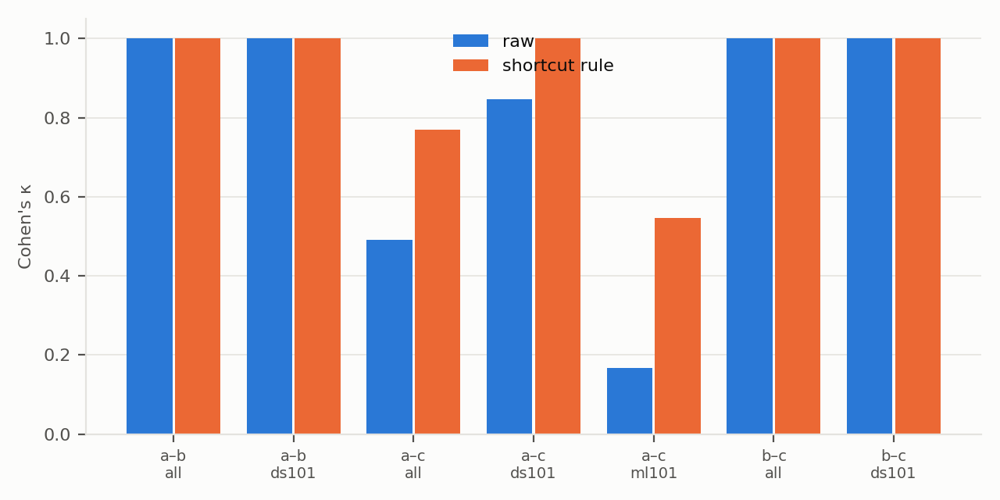
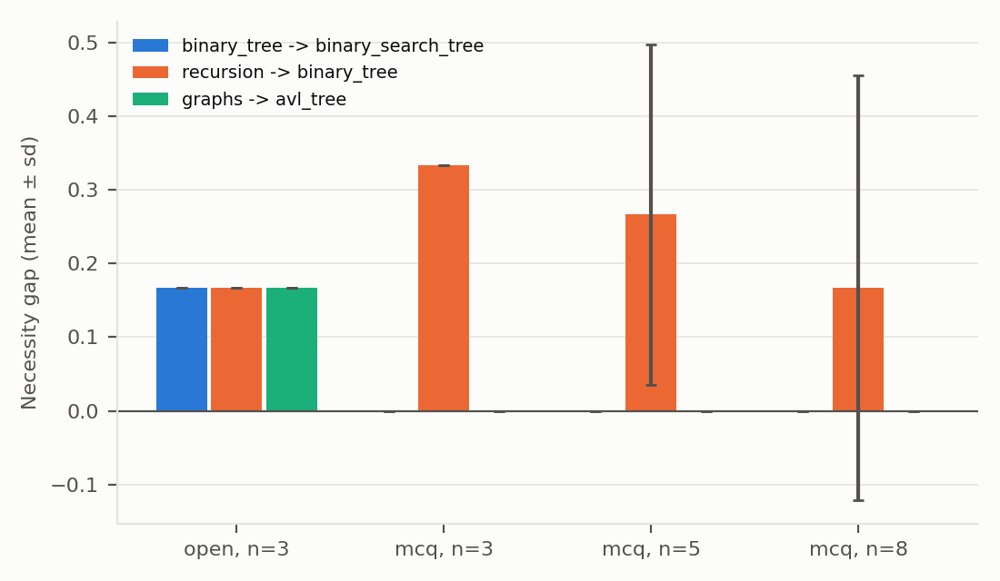
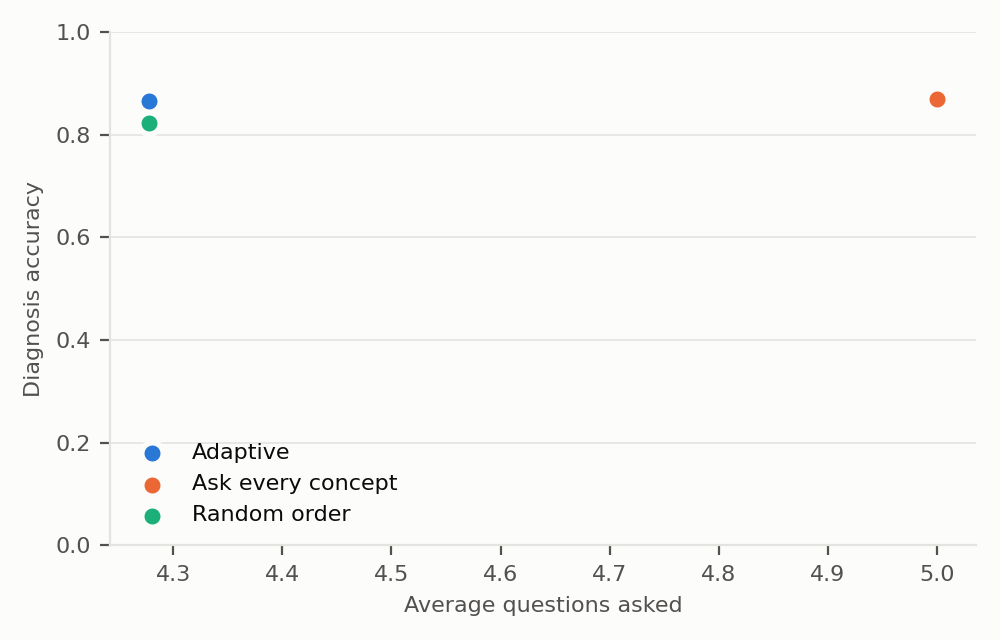

<!-- Generated by scripts/make_results.py; do not edit by hand. -->
# Paper tables

Cells reading [RESULT] have no results file yet.

## RQ1 — edge quality on ds101

| Setting | P | R | F1 | HUMAN_REVIEW rate | LLM calls / edge |
|---|---|---|---|---|---|
| discovery_only | [RESULT] | [RESULT] | [RESULT] | [RESULT] | [RESULT] |
| baseline_prompt | [RESULT] | [RESULT] | [RESULT] | [RESULT] | [RESULT] |
| single_judge | [RESULT] | [RESULT] | [RESULT] | [RESULT] | [RESULT] |
| self_consistency | [RESULT] | [RESULT] | [RESULT] | [RESULT] | [RESULT] |
| full_agent | [RESULT] | [RESULT] | [RESULT] | [RESULT] | [RESULT] |
| full_agent_plus_necessity | [RESULT] | [RESULT] | [RESULT] | [RESULT] | [RESULT] |
| minus_evidence | [RESULT] | [RESULT] | [RESULT] | [RESULT] | [RESULT] |
| minus_semantic | [RESULT] | [RESULT] | [RESULT] | [RESULT] | [RESULT] |
| minus_necessity | [RESULT] | [RESULT] | [RESULT] | [RESULT] | [RESULT] |
| minus_evidence_necessity | [RESULT] | [RESULT] | [RESULT] | [RESULT] | [RESULT] |
| minus_graph | [RESULT] | [RESULT] | [RESULT] | [RESULT] | [RESULT] |

Missing: `cdlp/validation/results/rq1_ds101.json` (python -m cdlp.validation.evaluate).

Sources: none yet

## RQ1 — edge quality on ml101

| Setting | P | R | F1 | HUMAN_REVIEW rate | LLM calls / edge |
|---|---|---|---|---|---|
| discovery_only | [RESULT] | [RESULT] | [RESULT] | [RESULT] | [RESULT] |
| baseline_prompt | [RESULT] | [RESULT] | [RESULT] | [RESULT] | [RESULT] |
| single_judge | [RESULT] | [RESULT] | [RESULT] | [RESULT] | [RESULT] |
| self_consistency | [RESULT] | [RESULT] | [RESULT] | [RESULT] | [RESULT] |
| full_agent | [RESULT] | [RESULT] | [RESULT] | [RESULT] | [RESULT] |
| full_agent_plus_necessity | [RESULT] | [RESULT] | [RESULT] | [RESULT] | [RESULT] |
| minus_evidence | [RESULT] | [RESULT] | [RESULT] | [RESULT] | [RESULT] |
| minus_semantic | [RESULT] | [RESULT] | [RESULT] | [RESULT] | [RESULT] |
| minus_necessity | [RESULT] | [RESULT] | [RESULT] | [RESULT] | [RESULT] |
| minus_evidence_necessity | [RESULT] | [RESULT] | [RESULT] | [RESULT] | [RESULT] |
| minus_graph | [RESULT] | [RESULT] | [RESULT] | [RESULT] | [RESULT] |

Missing: `cdlp/validation/results/rq1_ml101.json` (python -m cdlp.validation.evaluate).

Sources: none yet

## RQ1 — edge quality on al_cpl (micro)

| Setting | P | R | F1 | HUMAN_REVIEW rate | LLM calls / edge |
|---|---|---|---|---|---|
| discovery_only | [RESULT] | [RESULT] | [RESULT] | [RESULT] | [RESULT] |
| baseline_prompt | [RESULT] | [RESULT] | [RESULT] | [RESULT] | [RESULT] |
| single_judge | [RESULT] | [RESULT] | [RESULT] | [RESULT] | [RESULT] |
| self_consistency | [RESULT] | [RESULT] | [RESULT] | [RESULT] | [RESULT] |
| full_agent | [RESULT] | [RESULT] | [RESULT] | [RESULT] | [RESULT] |
| full_agent_plus_necessity | [RESULT] | [RESULT] | [RESULT] | [RESULT] | [RESULT] |
| minus_evidence | [RESULT] | [RESULT] | [RESULT] | [RESULT] | [RESULT] |
| minus_semantic | [RESULT] | [RESULT] | [RESULT] | [RESULT] | [RESULT] |
| minus_necessity | [RESULT] | [RESULT] | [RESULT] | [RESULT] | [RESULT] |
| minus_evidence_necessity | [RESULT] | [RESULT] | [RESULT] | [RESULT] | [RESULT] |
| minus_graph | [RESULT] | [RESULT] | [RESULT] | [RESULT] | [RESULT] |

Missing: `cdlp/validation/results/rq1_al_cpl_micro.json` (python -m cdlp.validation.evaluate).

Sources: none yet

## RQ1 — edge quality on university_course

| Setting | P | R | F1 | HUMAN_REVIEW rate | LLM calls / edge |
|---|---|---|---|---|---|
| discovery_only | [RESULT] | [RESULT] | [RESULT] | [RESULT] | [RESULT] |
| baseline_prompt | [RESULT] | [RESULT] | [RESULT] | [RESULT] | [RESULT] |
| single_judge | [RESULT] | [RESULT] | [RESULT] | [RESULT] | [RESULT] |
| self_consistency | [RESULT] | [RESULT] | [RESULT] | [RESULT] | [RESULT] |
| full_agent | [RESULT] | [RESULT] | [RESULT] | [RESULT] | [RESULT] |
| full_agent_plus_necessity | [RESULT] | [RESULT] | [RESULT] | [RESULT] | [RESULT] |
| minus_evidence | [RESULT] | [RESULT] | [RESULT] | [RESULT] | [RESULT] |
| minus_semantic | [RESULT] | [RESULT] | [RESULT] | [RESULT] | [RESULT] |
| minus_necessity | [RESULT] | [RESULT] | [RESULT] | [RESULT] | [RESULT] |
| minus_evidence_necessity | [RESULT] | [RESULT] | [RESULT] | [RESULT] | [RESULT] |
| minus_graph | [RESULT] | [RESULT] | [RESULT] | [RESULT] | [RESULT] |

Missing: `cdlp/validation/results/rq1_university_course.json` (python -m cdlp.validation.evaluate).

Sources: none yet

## RQ2 — diagnosis on simulated students

| Students | Strategy | Avg. questions | Accuracy |
|---|---|---|---|
| follows the graph | Graph-guided adaptive | 4.28 | 0.866 |
| follows the graph | Ask every concept | 5.00 | 0.870 |
| follows the graph | Random order (matched budget) | 4.28 | 0.824 |
| ignores the graph | Graph-guided adaptive | 3.64 | 0.775 |
| ignores the graph | Ask every concept | 5.00 | 0.874 |
| ignores the graph | Random order (matched budget) | 3.64 | 0.759 |

500 simulated students per condition, target avl_tree, mastery threshold 0.8; every strategy is scored on the same concepts with the same estimator. Share of students mastering a concept without all its prerequisites: follows the graph: 0.14, ignores the graph: 0.78.

Sources: `cdlp/learning_path/results/rq2_rq4_results.json`

## RQ3 — root-cause tracing on the gold test set

| Method | Mastery | n | Top-1 | Top-3 | LLM fallbacks |
|---|---|---|---|---|---|
| llm | [RESULT] | [RESULT] | [RESULT] | [RESULT] | [RESULT] |
| target | [RESULT] | [RESULT] | [RESULT] | [RESULT] | [RESULT] |
| nearest | [RESULT] | [RESULT] | [RESULT] | [RESULT] | [RESULT] |

Missing: a cdlp.root_cause.evaluate run on `data/gold/root_cause_testset.json`. Not tabled (dev set, never reported as test): `cdlp/root_cause/results/dev_set_baselines_no_mastery.json`, `cdlp/root_cause/results/dev_set_baselines_with_mastery.json`, `cdlp/root_cause/results/dev_set_llm_no_mastery.json`.

Sources: none yet

## RQ4 — personalized vs. generic paths

| Measure | follows the graph | ignores the graph |
|---|---|---|
| Generic path length (avg.) | 5.00 | 5.00 |
| Personalized path length (avg.) | 2.35 | 1.77 |
| Path length reduction | 52.9% | 64.6% |
| Gap coverage | 0.81 | 0.59 |
| Order violations (total) | 0 | 0 |

Sources: `cdlp/learning_path/results/rq2_rq4_results.json`

## Inter-annotator agreement (Cohen's κ, before adjudication)

| Annotators | Scope | Pairs | κ raw | κ shortcut rule |
|---|---|---|---|---|
| a vs b | all | 6 | 1.00 | 1.00 |
| a vs b | ds101 | 6 | 1.00 | 1.00 |
| a vs c | all | 20 | 0.49 | 0.77 |
| a vs c | ds101 | 10 | 0.85 | 1.00 |
| a vs c | ml101 | 10 | 0.17 | 0.55 |
| b vs c | all | 6 | 1.00 | 1.00 |
| b vs c | ds101 | 6 | 1.00 | 1.00 |

Shortcut rule: A pair labelled hard or soft becomes none if the same annotator's own hard/soft pairs already form a path from A to B through another concept. Labels changed by the rule: annotator a: 4. Unresolved ties before adjudication: 7.

Sources: `data/gold/merged/agreement.json`

## Concept extraction vs. hand-annotated concepts

| Extracted | Gold | P | R | F1 |
|---|---|---|---|---|
| 7 | 6 | 0.86 | 1.00 | 0.92 |

Sources: `cdlp/extraction/results/evaluation_metrics.json`

## Necessity-test stability (gap mean ± sd over seeds)

| Run | Format | n | Edge | Gap mean | Gap sd | Order holds (means) |
|---|---|---|---|---|---|---|
| necessity_stability | open | 3 | binary_tree -> binary_search_tree | 0.17 | 0.00 | no |
| necessity_stability | open | 3 | recursion -> binary_tree | 0.17 | 0.00 | no |
| necessity_stability | open | 3 | graphs -> avl_tree | 0.17 | 0.00 | no |
| necessity_stability | mcq | 3 | binary_tree -> binary_search_tree | 0.00 | 0.00 | no |
| necessity_stability | mcq | 3 | recursion -> binary_tree | 0.33 | 0.00 | no |
| necessity_stability | mcq | 3 | graphs -> avl_tree | 0.00 | 0.00 | no |
| necessity_stability | mcq | 5 | binary_tree -> binary_search_tree | 0.00 | 0.00 | no |
| necessity_stability | mcq | 5 | recursion -> binary_tree | 0.27 | 0.23 | no |
| necessity_stability | mcq | 5 | graphs -> avl_tree | 0.00 | 0.00 | no |
| necessity_stability | mcq | 8 | binary_tree -> binary_search_tree | 0.00 | 0.00 | no |
| necessity_stability | mcq | 8 | recursion -> binary_tree | 0.17 | 0.29 | no |
| necessity_stability | mcq | 8 | graphs -> avl_tree | 0.00 | 0.00 | no |
| necessity_stability_open5_qt07 | open | 5 | binary_tree -> binary_search_tree | 0.20 | [RESULT] | no |
| necessity_stability_open5_qt07 | open | 5 | recursion -> binary_tree | 0.40 | [RESULT] | no |
| necessity_stability_open5_qt07 | open | 5 | graphs -> avl_tree | 0.30 | [RESULT] | no |

Examples graph (3 edges); expected order: gap(edge 1) > gap(edge 2) > gap(edge 3), |gap(edge 3)| < weak.

Sources: `cdlp/validation/results/necessity_stability/summary.json`, `cdlp/validation/results/necessity_stability_open5_qt07/summary.json`

## Figures

